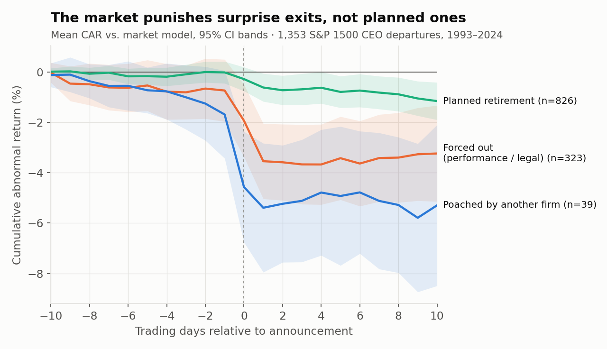
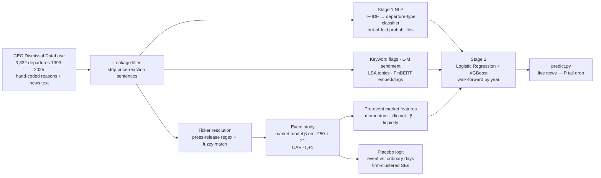
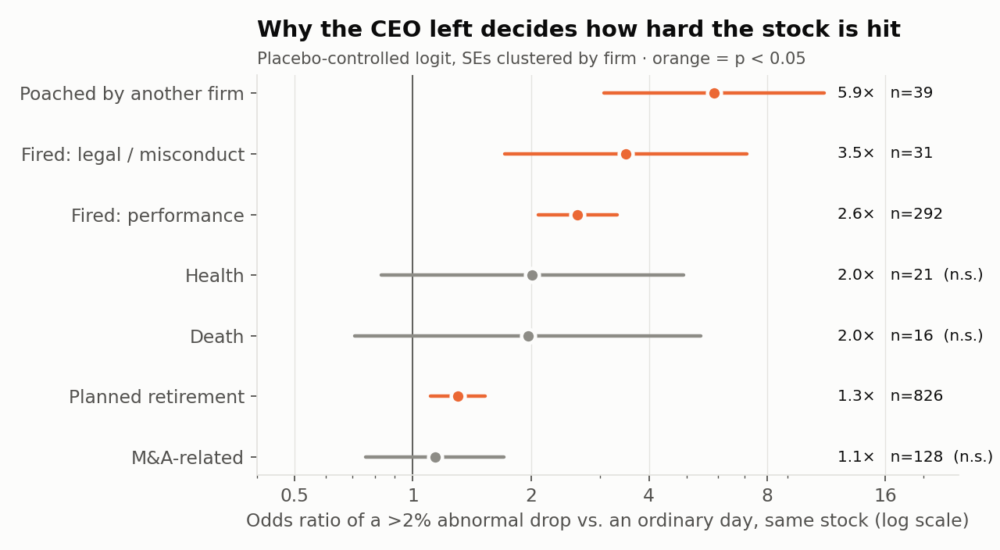
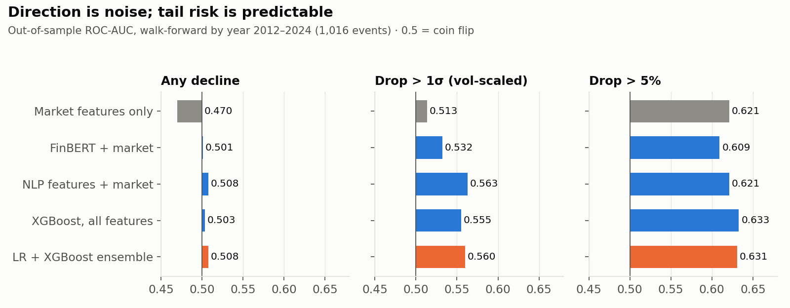
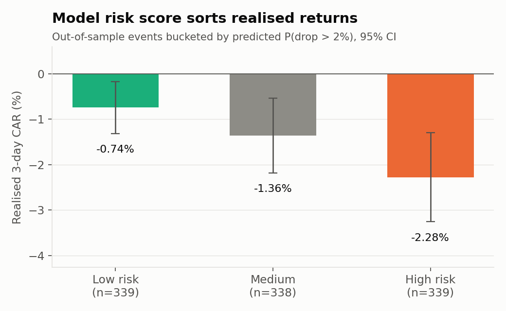

# CEO Exits & Equity Tail Risk

**An NLP + event-study pipeline that reads CEO-departure news and forecasts the probability of a
material abnormal stock drop. It is evaluated strictly out-of-sample with walk-forward validation.**

`event study` · `market-model abnormal returns` · `placebo-controlled logit` · `two-stage NLP stacking`
· `FinBERT transformer embeddings` · `XGBoost` · `walk-forward CV` · `leakage controls` · `ablation study`

---

## TL;DR

| | |
|---|---|
| **Does a CEO exit move the stock?** | Yes. The mean 3-day abnormal return is **−1.15% (t = −5.9)** across 1,353 departures. Against a placebo of ordinary days for the same stocks, an exit raises the odds of a >2% abnormal drop **1.65×** (p ≈ 10⁻¹⁴). |
| **Does the *type* of exit matter?** | It's the dominant factor. A CEO poached by a rival is worst (**5.9×** odds), then fired for misconduct (**3.5×**) and fired for performance (**2.6×**). Planned retirements barely register (1.3×). |
| **Can you predict it from the news?** | Direction, no: AUC 0.51, because 3-day idiosyncratic noise (σ ≈ 4%) swamps a 1% mean effect. **Tail risk, yes:** AUC **0.63** for >5% drops. On a volatility-normalised target the NLP features add **+5 AUC points** over market features alone. |
| **Is the signal economically meaningful?** | The model's high-risk tercile realised **−2.28%** CAR out-of-sample, against **−0.74%** for the low-risk tercile, a 3× spread. |
| **Live inference** | `predict.py` scores any new article, file or Google News feed for a ticker in seconds. |



---

## Architecture



---

## Design decisions

Each choice below targets a specific failure mode common in event-driven ML.

**1. Hand-labelled academic data instead of scraped headlines.**
The open-source **CEO Dismissal Database** (Gentry et al., *Strategic Management Journal*) supplies expert-coded
departure reasons *and* the underlying press-release text. That gives a clean supervised signal for the
"why did they leave" task, which a headline scraper could never provide.

**2. Abnormal returns, not raw returns.**
A raw return mixes the CEO news with the market's move that day. A **market model**
(β estimated on days −250…−21, with a gap so the estimate isn't contaminated by the event) isolates the
firm-specific reaction. A **[−1, +1] window** absorbs after-close announcements and date imprecision.

**3. A placebo-controlled test before any ML.**
Before predicting anything, the project establishes that the effect is real. It runs a logistic regression of
event days against **3,918 randomly drawn ordinary days for the same stocks**, with SEs clustered by firm. This
controls for firm-level drift and model misspecification, which a simple t-test on CARs cannot.

**4. Reframing the target from "down?" to "tail drop?"**
The naive target (sign of the return) is mostly noise: even the *true* hand-coded reason only reaches AUC 0.53.
Risk-relevant targets were tested instead: >2% and >5% abnormal drops, and a **volatility-normalised drop
(> 1σ of the stock's own 3-day idiosyncratic vol)**. The last one is the honest test of the NLP. Fixed-%
thresholds partly reward the model for spotting volatile stocks, while the σ-scaled target removes that
shortcut, isolating information that comes purely from the text.

**5. Two-stage NLP with out-of-fold stacking.**
Stage 1 is a TF-IDF classifier trained on all 3,332 texts. It infers the *departure type* from wording (76%
accuracy vs. 48% majority baseline), since live news never says "this is a performance dismissal." Its
probabilities feed Stage 2 through **out-of-fold predictions**, so the downstream model never sees in-sample
fits. Domain features sit alongside it: 19 trader-intuition flags ("effective immediately", interim CEO,
guidance cut, poached), Loughran-McDonald-style sentiment, LSA topics and **FinBERT** sentiment + embeddings.

**6. Leakage controls throughout.**
- Sentences describing the share-price reaction are regex-stripped from the text before modelling.
- Every fitted text component (TF-IDF, SVD, PCA on FinBERT, reason classifier) is **re-fit inside each fold**.
- **Walk-forward validation by year** (train < Y, test = Y, 2012–2024) mirrors live deployment. There is no shuffling across time.

**7. Interpretable baseline, nonlinear challenger, ablation.**
Regularised logistic regression (CV-tuned L2) is the interpretable baseline and XGBoost (shallow, heavily
regularised) is the nonlinear challenger. A formal **ablation** isolates what each feature family contributes,
including FinBERT.

---

## Results

### Effect size by departure type


### Out-of-sample predictive power


| Target | Base rate | Market only | NLP + market | XGBoost (all) | Ensemble |
|---|---|---|---|---|---|
| Any decline | 59% | 0.470 | 0.508 | 0.503 | 0.508 |
| Drop > 2% | 35% | 0.596 | 0.596 | 0.601 | **0.607** |
| Drop > 5% | 19% | 0.621 | 0.621 | **0.633** | 0.631 |
| Drop > 1σ (vol-scaled) | 28% | 0.513 | **0.563** | 0.555 | 0.560 |

*ROC-AUC, walk-forward 2012–2024, 1,016 out-of-sample events. Log-loss and Brier scores are in `reports/oos_metrics.csv`.*

### Economic significance


### FinBERT ablation
FinBERT tone tracks departure type strongly (mean P(negative) is 0.72 for misconduct firings vs 0.14 for
retirements), and on its own it beats market features on the σ-scaled target (0.532 vs 0.513). But it adds
**no incremental lift** over the domain-engineered features (0.560 vs 0.563). Its information is already
captured by the departure-type classifier and keyword flags. It stays in the served model for robustness on
messy live news text.

### What drives risk (standardised LR coefficients)
**Raises risk:** idiosyncratic vol, β, "resign", "poached / joining another company", earnings news released
the same day, legal or investigation language, FinBERT negativity.
**Lowers risk:** "retire", "personal reasons", activist involvement (plausibly read as a catalyst), liquidity, FinBERT positivity.

---

## Live inference

```bash
cd src
python predict.py --ticker UNH --date 2025-05-13 --text "UnitedHealth CEO Andrew Witty has resigned effective immediately for personal reasons... suspended its 2025 financial outlook"
python predict.py --ticker XYZ --file article.txt
python predict.py --ticker XYZ --fetch-news "XYZ CEO steps down"      # Google News RSS, last 7 days
```

```
=== UNH  news date 2025-05-13 ===
Inferred departure type: fired_performance 37%, health 21%, retired 14%
Text signals: immediate, successor_named, resign, earnings, cut_guidance, personal
FinBERT tone: negative 95%, neutral 5%, positive 1%

target (3-day CAR vs market model)       base     LR    XGB    ENS  OOS AUC(ens)
P(abnormal drop > 2%                )  33.5%  44.3%  39.4%  41.8%  0.607
P(abnormal drop > 5%                )  17.4%  24.9%  23.7%  24.3%  0.631
P(drop > 1 sigma (vol-scaled)       )  26.4%  44.2%  24.9%  34.6%  0.560
```
*(The stock fell about 18%. The model flagged elevated risk but understates how large the tail is.)*

---

## Repository

```
src/
  build_events.py   departure events + leakage-filtered news text
  map_tickers.py    company → ticker resolution
  event_study.py    prices, market-model CARs, pre-event features
  finbert.py        cached FinBERT sentiment + embeddings (Apple MPS / CPU)
  placebo.py        placebo-controlled logistic regression
  features.py       NLP feature engineering (shared by train + predict)
  train.py          walk-forward LR / XGBoost, ablation, final model
  predict.py        live inference CLI
  make_figures.py   README figures
reports/            metrics, OOS predictions, regression tables, figures
run.sh              full rebuild from raw data (~15 min)
```

## Limitations & next steps
- **Survivorship bias:** only firms with prices still available on Yahoo are kept (1,353 of 3,332), so delisted and acquired firms drop out. CRSP via WRDS would fix this.
- **Domain shift:** the training text is curated summaries plus press-release excerpts, while live input is raw news.
- **Timestamp precision:** EDGAR 8-K Item 5.02 timestamps would allow intraday event windows.
- **Modelling:** fine-tune FinBERT end-to-end on departure type; quantile regression on the left tail of CAR; LLM-based structured extraction (was the exit forced? is a successor ready? was guidance released the same day?).
- **Trading:** turning the risk score into a strategy needs borrow costs, announcement-time execution and a capacity analysis.

*Data: Gentry, Harrison, Quigley & Boivie, Open Sourced Database for CEO Dismissal (Zenodo 23328926). Prices: Yahoo Finance.*
